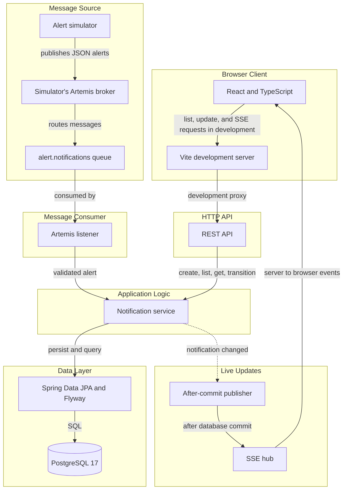
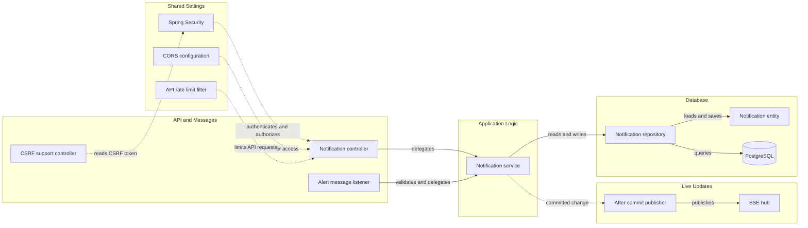

# Architecture Diagram

The Notification Board is a small full-stack application: a React client talks
to a Spring Boot API, PostgreSQL stores notification state, and an external
Artemis alert simulator supplies incoming messages.

## Application Architecture

<!-- mermaid-checked: no \n, no em-dash/en-dash, no {} in labels, subgraphs are id["label"], arrows are -->|"label"|, all subgraphs closed by end, ids unique -->

The REST API and message listener are two ways to send work to the same
notification service. The simulator sends JSON to its Artemis broker, and the
backend listener validates each message before calling the service directly;
it does not make an HTTP request to the REST API. The REST API also has a
create endpoint for API clients, but the frontend does not provide a create
form. The frontend lets operators view notifications and update their status.
After a database commit, the backend sends an SSE update to connected browsers;
the frontend then reloads its current page from the API. Vite proxies these
requests only during local development.

### Technology Stack Summary

| Layer | Technology | Version | Purpose |
|---|---|---|---|
| Browser | React | 19.x | Notification board UI |
| Browser | TypeScript | 5.x | Frontend types and build checking |
| Browser | Vite | 6.x | Development server and static production build |
| Backend | Java | 21 | Backend runtime |
| Backend | Spring Boot | 4.0.0 | REST API, dependency injection, configuration |
| Backend | Spring Data JPA | Spring Boot managed | Persistence and pagination |
| Backend | Spring Security | Spring Boot managed | HTTP Basic authentication and CSRF |
| Database | PostgreSQL | 17 in local Compose | Durable notification records |
| Messaging | Jakarta Messaging and Artemis | Spring Boot managed | Alert queue consumer and redelivery |
| Schema | Flyway | Spring Boot managed | Versioned database migrations |

### Data Storage & External Services

PostgreSQL stores the notifications. Flyway applies database changes, and
Hibernate checks the schema at startup without changing it. The local Compose
setup keeps database files in a named volume. The simulator runs separately
and sends JSON messages through its Artemis broker. The backend checks and
processes those messages. Browser updates use an in-memory SSE hub; there is no
shared update service for multiple backend instances.

### Key Architectural Decisions

- REST requests and messages use separate entry points but share one service,
  so status rules stay in one place without an extra internal HTTP call.
- The backend sends browser updates only after the database change is saved.
- PostgreSQL stores the data. SSE sends updates from the server to browsers.

## Component Relationships

<!-- mermaid-checked: no \n, no em-dash/en-dash, no {} in labels, subgraphs are id["label"], arrows are -->|"label"|, all subgraphs closed by end, ids unique -->

### Component Inventory

| Component | Layer | Type | Responsibility |
|---|---|---|---|
| `NotificationController` | API | Spring MVC controller | List, get, create, update status, and provide the SSE stream |
| `ApiSupportController` | API | Spring MVC controller | Provide the CSRF token needed for write requests |
| `AlertMessageListener` | Messages | JMS listener | Read, validate, and pass alerts to the service |
| `NotificationService` | Application logic | Spring service | Apply creation and status rules, save changes, and publish events |
| `NotificationSsePublisher` | Live updates | Transaction event listener | Send events after a database transaction succeeds |
| `NotificationSseHub` | Live updates | In-memory SSE hub | Send updates to browsers connected to this backend instance |
| `NotificationRepository` | Database | Spring Data repository | Read and save notification records |
| `NotificationEntity` | Database | JPA entity | Represent a notification in the database |
| `SecurityConfiguration` | Shared settings | Spring Security configuration | Set up sign-in, CSRF protection, password hashing, and access rules |
| `CorsConfiguration` | Shared settings | Spring configuration | Set which browser origin and methods are allowed |
| `ApiRateLimitFilter` | Shared settings | Servlet filter | Limit API requests per client IP in this backend instance |

This diagram shows the current implementation, not a production deployment
plan. See [DESIGN.md](./DESIGN.md) for limitations, tradeoffs, and ideas for
supporting more users and backend instances.
